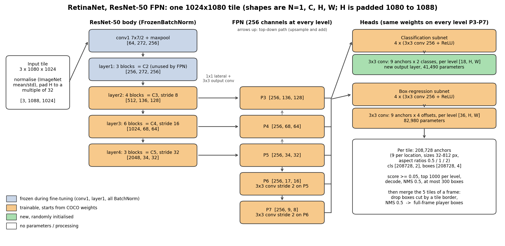

# Architecture and training choices (Phase I)

Everything numeric below comes from `results/model_description.json` (printed by `python -m soccer_tracking.describe_model`), `runs/finetune/` (training record) and the results in the README. Statements about torchvision's loss, matching and anchor code were checked against the installed torchvision source (`inspect.getsource`, section 5).

## 1. What the model is and why

The detector is torchvision's **RetinaNet with a ResNet-50 + FPN backbone**, a single-stage detector, fine-tuned from COCO weights to find one class, `player`.

| Need in this project | Design feature that addresses it |
|---|---|
| Very few objects, huge background: about 4-6 players in a tile against 208,728 anchors (about 40,000 anchors per player) | **Focal loss**: down-weights the many easy background anchors so they do not swamp the gradient |
| Players of different sizes (box height 27-99 px at the 5th-95th percentile across the three splits) | **Feature pyramid (FPN)**: predictions at 5 scales from one image pass |
| Small training set (2 matches) | **COCO-pretrained backbone and heads**: generic features and a `person` detector to start from; only the last classification layer is new |
| Compute: a free T4 GPU, no local GPU | A 32M-parameter single-stage model that trains in about 42 minutes (6 epochs) |

Class convention: output slot 1 = player; slot 0 is a spare slot that is always a negative target (torchvision's convention) (COCO's `person` is also slot 1, so the same evaluation code scores the pretrained and fine-tuned models).

## 2. What is original and what is not

**Not original (used as is):** the RetinaNet/ResNet-50/FPN architecture and COCO_V1 weights from torchvision, the focal loss and anchor matching inside it (Lin et al., RetinaNet; He et al., ResNet; Lin et al., FPN; COCO). No external code was copied or adapted; torchvision is used as a library.

**Own work in this project:** the tile-based input pipeline (native-scale 1024x1080 tiles with 128 px overlap, box-keeping rule), the replacement of the final classification layer for one class (`adapt_head`), the fine-tuning script (schedule, early stopping, logging, checkpoints), full-frame evaluation with tile merging (drop cut boxes, NMS), the metrics and error analysis, the IoU tracker and tracking measures, and the frozen experimental protocol. The architecture itself is unchanged apart from the final classification convolution.

## 3. Layer-level diagram and tensor flow



Shapes for one tile (width 1024, height 1080; the input transform pads the height to 1088, a multiple of 32; `min_size` 1024 and `max_size` 1080 mean the tile is **not rescaled**). Shapes are (N, C, H, W) with N = 1.

| Stage | Output shape | Stride | Notes |
|---|---|---|---|
| Input after transform | 1 x 3 x 1088 x 1024 | 1 | normalised with ImageNet mean (0.485, 0.456, 0.406) and std (0.229, 0.224, 0.225) |
| conv1 (7x7, stride 2) | 1 x 64 x 544 x 512 | 2 | frozen |
| maxpool | 1 x 64 x 272 x 256 | 4 | |
| layer1, 3 blocks (C2) | 1 x 256 x 272 x 256 | 4 | frozen; not used by the FPN |
| layer2, 4 blocks (C3) | 1 x 512 x 136 x 128 | 8 | trainable |
| layer3, 6 blocks (C4) | 1 x 1024 x 68 x 64 | 16 | trainable |
| layer4, 3 blocks (C5) | 1 x 2048 x 34 x 32 | 32 | trainable |
| FPN P3 / P4 / P5 | 1 x 256 x 136 x 128 / 68 x 64 / 34 x 32 | 8 / 16 / 32 | 1x1 lateral convs on C3-C5, top-down add, 3x3 output convs |
| FPN P6 / P7 | 1 x 256 x 17 x 16 / 9 x 8 | 64 / 128 | two stride-2 3x3 convs (256 to 256 channels, so P6 is computed from P5) |
| Classification head, per level | 1 x 256 x H x W (after 4 conv+ReLU), then 1 x 18 x H x W | | 18 = 9 anchors x 2 classes; same weights at every level |
| Box head, per level | 1 x 256 x H x W, then 1 x 36 x H x W | | 36 = 9 anchors x 4 box offsets |
| All levels flattened | class logits 1 x 208,728 x 2; box offsets 1 x 208,728 x 4 | | 208,728 = 9 x (136x128 + 68x64 + 34x32 + 17x16 + 9x8) |
| After post-processing | N x 4 boxes, N scores, N labels | | score >= 0.05, top 1000 per level, NMS 0.5, at most 300 per tile |

A frame (4096x1080) is cut into 5 overlapping tiles; the per-tile detections are merged (boxes cut by an interior tile border are dropped, then NMS at 0.5) into full-frame boxes before any metric or tracking step.

## 4. Parameters, frozen and trainable

| Component | Parameters | Trainable |
|---|---|---|
| ResNet-50 body | 23,454,912 | 23,232,512 |
| FPN (inner 918,272 + output 1,770,240 + P6/P7 1,180,160) | 3,868,672 | 3,868,672 |
| Classification head (tower 2,360,320 + final conv 41,490) | 2,401,810 | 2,401,810 |
| Box-regression head (tower 2,360,320 + final conv 82,980) | 2,443,300 | 2,443,300 |
| **Total** | **32,168,694** | **31,946,294** |

The 222,400 frozen parameters are `conv1` (9,408) and `layer1` (212,992). All batch-normalisation layers in the backbone are `FrozenBatchNorm2d`: they keep the COCO statistics and are never updated. This is torchvision's configuration when COCO weights are loaded (trainable backbone layers = 3, the default); it was not changed in this project. The trainable count (31,946,294) equals the one recorded in the training config.

## 5. Anchors, matching and loss

- **Anchors:** 9 per location (3 sizes x aspect ratios 0.5, 1, 2). Sizes per level: P3 32/40/50, P4 64/80/101, P5 128/161/203, P6 256/322/406, P7 512/645/812 px. Players are small (median about 20 x 45 px at native scale), so almost all useful matches are at P3 and P4; P5-P7 hold 12,888 of the 208,728 anchors (6%) and their anchors are larger than essentially every player. The aspect ratio is height/width (`AnchorGenerator.generate_anchors` sets height = sqrt(ratio) x size and width = size / sqrt(ratio)), so the smallest anchor at ratio 2 is about 23 x 45 px before rounding to whole pixels, close to the median player.
- **Matching:** an anchor is positive if its IoU with a player is at least 0.5 and negative below 0.4; the best anchor of each player is kept as positive even if below 0.5 (`allow_low_quality_matches = True`, read from the model); anchors between the two thresholds are ignored by the classification loss (`BETWEEN_THRESHOLDS`, checked in the source).
- **Classification loss:** sigmoid focal loss, called without alpha or gamma arguments so torchvision's defaults apply (alpha = 0.25, gamma = 2, read from the function signature), summed over the valid anchors of an image and divided by that image's number of positive anchors (at least 1), then averaged over the images of the batch (checked in `RetinaNetClassificationHead.compute_loss`).
- **Box loss:** an L1 loss (type read from the model) between the head's output and the box offsets that torchvision's box coder derives from each positive anchor and its matched player box, divided by that image's number of positive anchors (at least 1) and averaged over the batch (checked in `RetinaNetRegressionHead.compute_loss`; the body of the helper `_box_loss` was not inspected).
- **Initialisation of the new layer:** the final classification convolution (41,490 parameters) is re-initialised with weights ~ N(0, 0.01) and bias -log((1 - 0.01)/0.01) = about -4.6, so every anchor starts with a 1% foreground probability (the standard RetinaNet prior; `adapt_head` in `src/soccer_tracking/detect.py`).

## 6. Fine-tuning strategy

1. Start from COCO weights (the pretrained model already detects `person`: AP50 0.657 on validation and 0.788 on test without any training).
2. Replace only the final classification convolution for 2 classes (new, random init); keep everything else, including the box-regression convolution.
3. Freeze `conv1`, `layer1` and all batch norm (generic low-level features; with a batch of 4 tiles, batch statistics would be unreliable); train `layer2`-`layer4`, the FPN and both heads (31.9M parameters).
4. Train on tiles of two matches (118575, 118576): 2,395 tiles, every 25th frame, horizontal flip with probability 0.5.

## 7. Training choices and why

None of these was tuned by search; they are standard starting values, and the evidence column says what the run showed.

| Choice | Value | Reason | Evidence |
|---|---|---|---|
| Optimiser | SGD, momentum 0.9, weight decay 1e-4 | The usual optimiser for detection fine-tuning; weight decay is the regulariser | Loss fell steadily over 6 epochs |
| Learning rate | peak 0.005, 100 iterations of linear warmup, cosine decay to 1% of the peak | Warmup avoids unstable first steps; cosine gives a smooth end | One loss spike (about 2.4) at iteration 100 when the rate reached its peak; recovered within a few iterations, so 0.005 is near the upper limit for batch 4 |
| Gradient clipping | max norm 10 | Protects against spikes | Spike did not derail training |
| Batch size | 4 tiles | Fits the T4 with mixed precision; not searched | Steady about 0.61 s per iteration |
| Mixed precision | fp16 autocast with a gradient scaler | Speed and memory on the T4 | No NaN losses |
| Epochs and stopping | up to 8; stop after 3 epochs without validation-AP50 improvement | Avoid wasted compute and overfitting | Best epoch 3; stopped after epoch 6 |
| Selection metric | validation AP50 (chosen before training) | Matches the first success criterion | AP50 plateaued from epoch 1 (see below) |
| Augmentation | horizontal flip only | Players are left-right symmetric; no pitch coordinates are used | No scale or colour augmentation: a known limit |
| Seed | 0 (data order, flips, initialisation); one run only | Reproducibility | GPU training is not bit-exact; no variance across seeds was measured |

## 8. What the learning curves show

| Epoch | Mean train loss | Val AP50 | Val AP75 | Precision | Recall |
|---|---|---|---|---|---|
| 1 | 0.259 | 0.954 | 0.783 | 0.908 | 0.936 |
| 2 | 0.141 | 0.952 | 0.823 | 0.861 | 0.956 |
| **3** | 0.123 | **0.959** | 0.860 | 0.874 | 0.958 |
| 4 | 0.108 | 0.956 | 0.862 | 0.877 | 0.962 |
| 5 | 0.094 | 0.957 | 0.877 | 0.895 | 0.962 |
| 6 | 0.088 | 0.955 | 0.880 | 0.889 | 0.962 |

(48 validation frames of match 117093; precision and recall at score 0.5, IoU 0.5; curves in `runs/finetune/curves.png`.)

- **Training loss fell every epoch; validation AP50 did not move after epoch 1** (0.952-0.959, probably within sampling noise for 1,056 boxes). The easy part, finding the players, was learned within one epoch.
- **Validation AP75 kept rising** (0.783 to 0.880): later epochs mainly improve how tightly boxes fit. AP50 therefore stopped being informative as a selection metric, and early stopping on it ended the run at epoch 6, before the 8-epoch cosine schedule finished (the learning rate was still about 0.0008). The epoch-3 checkpoint was kept because the rule was fixed in advance; choosing epoch 6 afterwards would be tuning on the same validation clip.
- **No sign of overfitting in the validation metrics** over 6 epochs; held-out test AP50 (0.950) is close to validation (0.959). With one run, one validation clip and two training matches this is limited evidence, not proof of generalisation to other stadiums or cameras.

## 9. Syllabus links

| Unit | Where it appears |
|---|---|
| I | SGD with momentum, backpropagation through a deep network, parameters versus hyperparameters (learning rate, batch size, weight decay) |
| II | Tensor shapes and reshaping through the network; flattening 5 feature maps into one anchor axis |
| III | Convolution (2D), ReLU, loss functions, bias initialisation, normalisation (frozen batch norm), regularisation (weight decay, early stopping), data augmentation (flip), generalisation (validation versus test) |
| IV | Object detection, RetinaNet, ResNet backbone, feature pyramid, anchors, NMS, AP |

## 10. Limitations and ideas (suggestions, not done)

- Small players are the weakest group (recall 0.757 under 30 px on validation). The P5-P7 levels are almost unused for this data; smaller anchors, or enlarging tiles by about 1.5x, are untested ideas.
- Crowded players account for 37 of the 44 validation misses; a softer or tighter NMS setting, or a higher-resolution feature level, are untested ideas.
- AP50 saturates after one epoch; selecting by AP75 or the mean of AP50 and AP75 would use the remaining epochs.
- Only horizontal flip is used; scale and colour augmentation might help on other footage.
- A score threshold near 0.7 would probably give a better F1 than 0.5 on validation (estimated from the error analysis); the protocol fixed 0.5.
- Two training matches and one run: more matches and several seeds would give a variance estimate.

## 11. Reproduce

```powershell
$env:PYTHONPATH = "src"
python -m soccer_tracking.describe_model        # layers, parameters, shapes -> results/model_description.json
python docs/figures/make_architecture_figure.py # redraws the diagram (needs only matplotlib)
```

Training, evaluation, error analysis and the tracking comparison are in the README ("Training on a hosted GPU", "Results", "Error analysis", "Tracking comparison").
